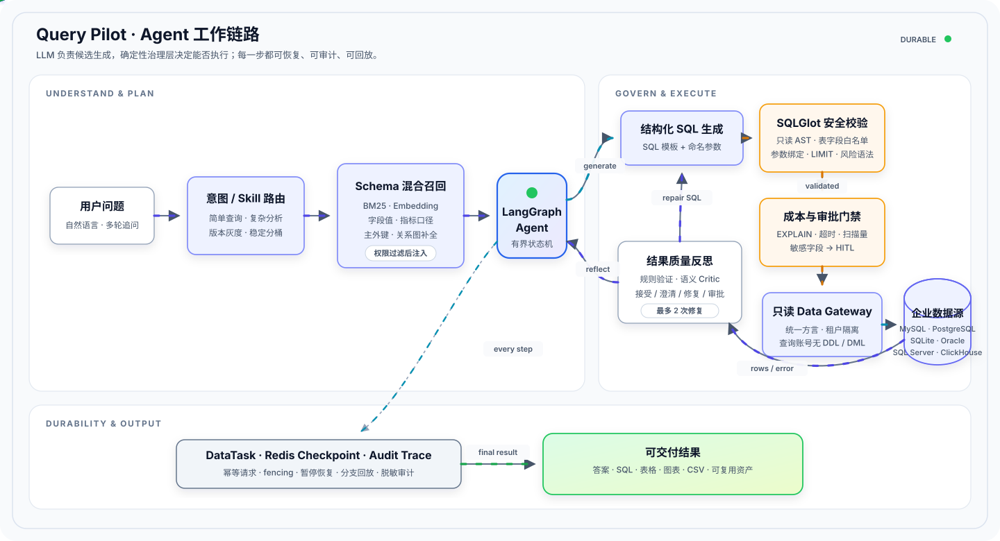

<div align="center">

# Query Pilot

**面向企业数据场景的安全、可恢复、可审计 NL2SQL Agent**

用自然语言完成数据查询、分析与可视化，同时让每一条 SQL 都经过权限、安全、成本和审批校验。

[](https://github.com/Amsit-rick/QueryPilot/actions/workflows/ci.yml)


[快速开始](#快速开始) · [核心能力](#核心能力) · [执行链路](#执行链路) · [数据源支持](#数据源支持) · [质量证据](#质量与验证) · [文档](#文档导航)

</div>

> **核心原则：LLM 只生成候选 SQL，不拥有数据库执行权。** 真实执行由确定性的身份权限、Schema 白名单、SQLGlot AST、成本门禁、人工审批和只读 Data Gateway 共同决定。

## Query Pilot 是什么

Query Pilot 不是一个只会把问题翻译成 SQL 的聊天框，而是一套围绕 **NL2SQL + Agent 治理 + DataTask 持久化** 构建的数据分析工作台。

它将用户问题转换为结构化 SQL 计划，执行前完成 Schema 召回、权限过滤、SQL 安全校验和成本评估，执行后生成答案、表格、图表和 CSV，并把步骤、事件、结果资产与审计信息保存在任务中。

```text
自然语言问题
  → 意图与 Skill 路由
  → 权限过滤后的 Schema / 指标 / 字段值 / 关系召回
  → LLM 生成结构化 SQL 与参数
  → SQLGlot AST + RBAC + EXPLAIN + 审批门禁
  → 只读 Data Gateway 执行
  → 结果验证、反思与有界修复
  → DataTask 持久化、回放与多轮追问
```

## 为什么需要它

| 真实问题 | Query Pilot 的处理方式 |
|---|---|
| 上千张表无法全部塞进 Prompt | 先按账号权限过滤，再混合召回表、字段、指标、字段值和关系路径 |
| 模型可能产生越权或危险 SQL | 使用方言 AST、表字段白名单、参数绑定、只读账号和危险语法拦截 |
| JOIN 路径复杂、主外键跨表 | 结合数据库主外键、人工关系目录和桥接表补全候选路径 |
| 慢 SQL、全表扫描可能压垮数据库 | 执行前运行方言化 EXPLAIN，检查扫描量、超时、索引和成本阈值 |
| 多轮上下文可能继承旧权限 | 每轮重新校验身份、Schema、权限、安全、成本与审批策略 |
| Agent 中断后任务无法恢复 | 使用 DataTask、幂等请求、Checkpoint、fencing token 和版本化事件恢复 |
| 模型成本不可见 | 每轮展示输入、输出、总 Token 与可配置人民币估算，并保存到结果资产 |

## 快速开始

### 环境要求

- Windows 10 / 11
- Python 3.12
- Node.js 22
- Docker Desktop

### 1. 首次安装

在项目根目录打开 **CMD**：

```cmd
scripts\setup_local.cmd
```

脚本会创建虚拟环境、安装前后端依赖、生成 Git 忽略的 `.env`、启动 MySQL、执行迁移、导入演示数据并创建本地管理员。

查看自动生成的管理员密码：

```cmd
findstr /B "LOCAL_ADMIN_PASSWORD=" .env
```

### 2. 启动项目

后续启动只需执行：

```cmd
scripts\start_local.cmd
```

| 服务 | 地址 |
|---|---|
| Web 工作台 | `http://127.0.0.1:5173` |
| Swagger UI | `http://127.0.0.1:8000/docs` |
| OpenAPI JSON | `http://127.0.0.1:8000/openapi.json` |
| 健康检查 | `http://127.0.0.1:8000/health` |

不配置模型密钥时，可以测试显式只读 SQL 和内置确定性模板。要让任意自然语言问题生成 SQL，需要在 `.env` 中配置 `MODEL_API_KEY` 并重启服务。

安装、端口冲突和常见故障见 [`docs/local-start.md`](docs/local-start.md)。

## 核心能力

### 受控 NL2SQL Agent

- LangChain 负责模型适配、Prompt 和结构化 `SqlPlan` 输出；
- LangGraph 编排生成、校验、执行、验证、反思和修复节点；
- SQL 模板与参数值分离，用户条件使用命名参数绑定；
- 简单确定性问题可绕过模型，降低延迟和 Token 成本。

### 大规模 Schema 与关系召回

- 权限过滤后的 BM25、可插拔 Embedding、业务指标和字段值混合召回；
- 从数据库元数据读取主键、外键和字段信息；
- 使用关系图补齐桥接表和候选 JOIN 路径；
- 支持 1500 表规模的合成 Schema 召回评测与失败归因。

### SQL 安全与成本治理

- SQLGlot 多方言 AST，只放行授权范围内的单条只读查询；
- 表字段白名单、危险函数与高风险结构拦截、LIMIT 和查询超时；
- RBAC、租户隔离、行级过滤、敏感字段脱敏和数据库只读账号；
- EXPLAIN 成本门禁、人工审批和完整审计日志。

### Durable Agent 与多轮分析

- DataTask 持久化任务、步骤、事件、反思记录和结果资产；
- 支持请求幂等、断线续传、Redis Checkpoint、恢复租约与 fencing token；
- 多轮上下文采用有界投影，不把结果行、参数和失败 SQL直接写回 Prompt；
- 可从任意成功轮次创建独立分析分支，并重新执行当前安全策略。

### 结果交付与成本回执

- 返回自然语言答案、受控 SQL、表格和常见统计图表；
- 使用受控原生 SVG 绘制条形图、柱状图、折线图和饼图；
- 支持 CSV 导出和 Redis 异步 Worker；
- 每轮显示输入、输出、总 Token 和人民币近似成本，刷新历史任务后仍可恢复。

### MCP 与 Skill 扩展

- 提供标准 MCP 2.x 只读服务；
- 暴露 Schema、查询规划、任务状态、结果读取和 Skill 路由能力；
- 支持声明式 Skill 的版本、评测、灰度、发布和回滚；
- MCP 不提供绕过现有审批和 SQL 安全边界的裸执行通道。

## 执行链路

<p align="center">
  
</p>

动态图中的流光和移动箭头表示执行方向；系统启用“减少动态效果”时会自动降级为静态图。

链路遵循三个约束：

1. **候选生成与执行授权分离**：模型输出不能直接进入数据库。
2. **判定逻辑独立**：权限、安全、成本和结果质量由确定性服务或独立 Critic 判定。
3. **全过程可回放**：每一步都进入 DataTask，不依赖一次性聊天内存维持状态。

## 可以完成什么

- 查询、过滤、聚合、排序、分组和多表关联数据；
- 使用同一个任务继续多轮追问；
- 从历史轮次创建假设分析分支并比较结果；
- 查看 SQL、执行步骤、审批状态、反思决策和结果资产；
- 生成表格与常见统计图形，并导出 CSV；
- 对敏感字段、高风险查询和导出请求执行人工审批；
- 通过 MCP 获取 Schema、查询计划、任务状态和脱敏结果。

## 数据源支持

| 数据库 | 统一接入状态 | Schema / 查询 / 安全链路 | 数据库原生能力差异 |
|---|---|---|---|
| SQLite | 已接入并验收 | 页面可选，支持 Schema、只读查询、参数绑定和 SQL 安全校验 | 支持关系元数据与成本估算，适合本地演示和轻量开发 |
| MySQL | 已接入并验收 | 页面可选，支持 Schema、只读查询、参数绑定和 SQL 安全校验 | 支持关系元数据与 `EXPLAIN FORMAT=JSON` 成本估算 |
| PostgreSQL | 已接入并验收 | 页面可选，支持 Schema、只读查询、参数绑定和 SQL 安全校验 | 支持关系元数据与 `EXPLAIN (FORMAT JSON)` 成本估算 |
| Oracle 19c | 已接入并验收 | 页面可选，支持深度 Schema、只读查询、命名参数绑定和 SQL 安全校验 | 支持主外键、多 Schema、主动取消；独立 Planner 提供 EXPLAIN |
| SQL Server | 已接入并验收 | 页面可选，支持深度 Schema、只读查询、参数绑定和 SQL 安全校验 | 支持主外键、多 Schema、主动取消与 `SHOWPLAN_XML` 成本估算 |
| ClickHouse | 已接入并验收 | 页面可选，支持深度 Schema、只读查询、参数绑定和 SQL 安全校验 | 支持多 Database、主动取消与 `EXPLAIN ESTIMATE`；无传统外键契约 |

六种数据库已经统一到同一条产品链路：页面真实可选、Schema 可读取、自然语言查询可执行、只读账号与 SQL 安全门禁生效，并已在本机完成真实连接和查询验收。表中差异仅指各数据库原生的关系元数据、EXPLAIN 和成本模型能力，不代表 Oracle、SQL Server 或 ClickHouse 只能实验连接或不能真实查询。

“已接入”不等于无条件显示。只有在数据源目录中登记、连接配置完整且当前用户获授权的实例，才会出现在页面中。

后三类远程 Gateway 使用进程内有界连接池、空闲 TTL、归还前回滚和异常连接淘汰；可选 TLS 配置采用失败关闭。多 Schema / Database 必须同时配置 `namespaces` 与限定名表白名单，例如 `finance.sales`，未授权限定名和三段式跨数据库引用仍会被 SQL 安全层拒绝。

开启 `START_ALL_DATASOURCES=true` 后，标准启动流程会启动已配置的本地数据库，并在 API 启动前执行连接、Schema 和真实只读查询验证；任一要求启用的实例未就绪时失败关闭。

## 安全模型

Query Pilot 使用分层防护，不把系统提示词当作最终安全边界：

1. **身份与权限层**：JWT、RBAC、租户隔离、数据源授权和行级范围。
2. **生成层**：Prompt 注入检测、候选 Schema 注入、结构化 SQL 与参数输出。
3. **静态校验层**：SQLGlot AST、只读语句、表字段白名单、危险函数与复杂度检查。
4. **执行层**：命名参数绑定、只读数据库账号、LIMIT、超时、EXPLAIN 和审批。
5. **结果层**：字段脱敏、预览边界、导出审批、审计事件和可观测指标。

生产环境仍应使用企业网关、Vault/KMS、独立只读账号、出口网络控制、集中日志和正式备份策略。

## API 示例

登录并取得 Bearer Token 后：

```http
POST /api/v1/query
Authorization: Bearer <access_token>
Content-Type: application/json
```

```json
{
  "question": "查询各区域销售额并按金额从高到低排序",
  "datasource": "mysql-main"
}
```

响应包含任务 ID、受控 SQL、结果、分析摘要和本轮 Token 成本回执：

```json
{
  "task_id": "...",
  "answer": "查询完成，共返回 4 行。",
  "row_count": 4,
  "usage": {
    "input_tokens": 859,
    "output_tokens": 54,
    "total_tokens": 913,
    "cost_cny": 0.00139736,
    "cost_cny_estimated": true,
    "usage_source": "provider"
  }
}
```

人民币金额由本地可配置单价估算，始终不等同供应商最终账单。完整参数、权限和测试流程见 [`docs/api-test-guide.md`](docs/api-test-guide.md)。

## 技术栈

| 层次 | 技术 |
|---|---|
| Agent / LLM | LangGraph、LangChain、DeepSeek / OpenAI 兼容模型 |
| 后端 | Python 3.12、FastAPI、Pydantic |
| SQL 治理 | SQLGlot、参数绑定、方言化 EXPLAIN |
| 数据源 | MySQL、PostgreSQL、SQLite、Oracle、SQL Server、ClickHouse |
| 状态与队列 | Redis、MySQL DataTask Repository |
| 前端 | Vue 3、Vue Router、受控原生 SVG 图表 |
| 工程化 | Docker Compose、Pytest、Playwright、Prometheus、Grafana、GitHub Actions |

<details>
<summary><strong>常用开发验证命令</strong></summary>

后端测试：

```cmd
.venv\Scripts\python.exe -m pytest -q
```

前端生产构建：

```cmd
cd frontend
npm run build
```

浏览器 E2E：

```cmd
cd frontend
npx playwright test
```

部署前检查：

```cmd
.venv\Scripts\python.exe scripts\doctor.py
```

</details>

## 质量与验证

GitHub Actions 持续执行：

- 后端全量回归和 SQL 安全高风险语料；
- 前端生产构建、依赖检查和 Playwright 浏览器 E2E；
- 配置、迁移、密钥泄漏和发布证据检查；
- 反思动作、结果质量和安全组合门禁。

仓库包含千余条后端自动化回归、浏览器 E2E、SQL 安全语料、1500 表合成 Schema 召回评测，以及版本化 Gold Question / SQL / Result 数据集。

30 条未参与调参的合成业务留出集上，枚举值接地将端到端结果一致率从 **86.7%** 提升到 **93.3%**。该数据用于验证工程方法，**不代表真实企业数据准确率或生产验收结论**。

评测方法、数据口径和失败归因见 [`docs/testing/business-gold-mysql-eval.md`](docs/testing/business-gold-mysql-eval.md)。

## 文档导航

| 文档 | 内容 |
|---|---|
| [`docs/local-start.md`](docs/local-start.md) | Windows 安装、启动和故障排查 |
| [`docs/api-test-guide.md`](docs/api-test-guide.md) | API 字段、权限和测试流程 |
| [`docs/schema-retrieval.md`](docs/schema-retrieval.md) | 千表级 Schema 召回与关系路径规划 |
| [`docs/query-cost-and-relationships.md`](docs/query-cost-and-relationships.md) | EXPLAIN 成本门禁、主外键与人工关系目录 |
| [`docs/conversation-compaction.md`](docs/conversation-compaction.md) | 多轮上下文投影与安全过滤 |
| [`docs/task-recovery-runbook.md`](docs/task-recovery-runbook.md) | Checkpoint、fencing、恢复和回放 |
| [`docs/reflection-mechanism-roadmap.md`](docs/reflection-mechanism-roadmap.md) | 结果反思、Critic、灰度与评测 |
| [`docs/mcp-skills.md`](docs/mcp-skills.md) | MCP Server、Skill 路由和发布治理 |
| [`docs/model-operations.md`](docs/model-operations.md) | 模型提供商、提示词版本与密钥引用 |
| [`docs/testing/token-usage-cost-receipt.tdd.md`](docs/testing/token-usage-cost-receipt.tdd.md) | Token 与人民币成本回执 |
| [`docs/operations/production-security-acceptance.md`](docs/operations/production-security-acceptance.md) | 生产安全证据与外部待验收项 |
| [`部署运行手册.md`](部署运行手册.md) | Docker、监控、备份、恢复和部署 |

## 项目结构

```text
app/                 FastAPI、Agent、SQL 治理与应用服务
frontend/            Vue 3 工作台与 Playwright E2E
data/                演示数据、目录、策略与评测集
scripts/             安装、启动、迁移、验收和评测脚本
docs/                架构、测试、安全、运维和使用文档
deploy/              Prometheus、Grafana、Nginx 等部署配置
tests/               后端单元、集成、安全和回归测试
```

## 适用范围与能力边界

**适合：** NL2SQL 工程实践、企业数据 Agent 原型、SQL 安全治理、多轮数据分析、Agent 持久化与恢复机制验证。

**当前不应直接视为：** 已完成生产容量、真实企业准确率、Redis 高可用、灾备、许可证合规和全部目标数据库参数校准的商业化产品。

- 仓库中的业务数据和规模评测数据为可重复生成的合成数据；
- 数据库生产使用前必须针对目标实例重新校准权限、索引、超时和成本阈值；
- Embedding、外部模型、告警通知、Redis HA 和企业密钥系统需要在目标基础设施中单独验收；
- 本地 `.env`、演示账号和 Docker 配置不能直接复用于生产环境。

---

<div align="center">

**Query Pilot：让模型负责理解问题，让确定性系统负责守住数据边界。**

</div>
