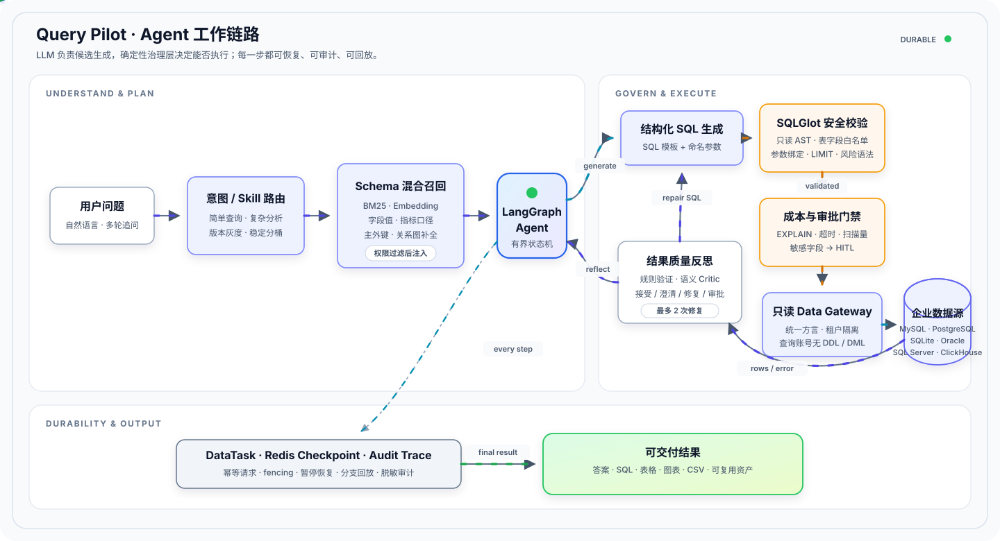

# Query Pilot — 面向企业场景的 NL2SQL 数据分析 Agent

[](https://github.com/Amsit-rick/QueryPilot/actions/workflows/ci.yml)

Query Pilot 将中文自然语言问题转换为**经过权限、安全、成本和审批校验的只读 SQL**，并把查询过程沉淀为可恢复、可审计、可回放的 DataTask。

它不是让大模型直接连接数据库。模型只负责生成候选 SQL，真正决定“能不能执行”的是确定性的 Schema 权限、SQLGlot AST 护栏、EXPLAIN 成本门禁、人工审批和只读 Data Gateway。

## 项目解决什么问题

企业 NL2SQL 的难点不只是“生成一条语法正确的 SQL”：

- 业务库可能有上千张表，无法把完整 Schema 一次性塞给模型；
- 主外键、软关系、指标口径和字段值会直接影响 JOIN 与过滤条件；
- 模型可能生成越权字段、危险语句、笛卡尔积或高成本查询；
- 多轮追问需要继承上下文，但不能继承已经失效的权限和数据；
- 一次性聊天回答无法满足审批暂停、异常恢复、审计和结果复用。

Query Pilot 围绕这些问题构建了完整的 Agent 执行与治理链路。

## 核心能力

| 能力 | 实现 |
|---|---|
| 受控 NL2SQL | LangChain 模型适配与结构化 `SqlPlan` 输出，SQL 模板和参数值分离，LangGraph 编排生成、校验、执行、反思和修复 |
| 大规模 Schema 召回 | 权限过滤后的 BM25、可插拔 Embedding、字段值、业务指标和关系图混合召回；按主外键补齐桥接表和 JOIN 路径 |
| SQL 安全治理 | SQLGlot 方言 AST、只读 SELECT、表字段白名单、参数绑定、LIMIT、危险函数拦截、行级过滤、字段脱敏和数据库只读账号 |
| 成本与审批门禁 | 执行前运行 EXPLAIN，检查扫描量、全表扫描、超时和成本阈值；敏感字段和高风险操作进入 Human-in-the-Loop 审批 |
| Durable Agent | DataTask 持久化任务、步骤、事件和结果资产；Redis Checkpoint、fencing token、幂等请求、断线续传、恢复与回放 |
| 多轮与分支分析 | 使用有界上下文继续追问；历史信息按当前 Schema 权限重新过滤；支持从任意成功轮次创建独立分析分支 |
| 结果质量反思 | 确定性规则与可选语义 Critic 独立判定接受、澄清、审批或修复；最多两次修复，避免无限循环 |
| 扩展能力 | MySQL、PostgreSQL、SQLite、Oracle、SQL Server、ClickHouse 多数据源接入；只读 MCP 2.x 服务与版本化 Skill 治理 |

## 工作链路

<p align="center">
  
</p>

图中的流光和移动箭头表示执行方向；启用“减少动态效果”时自动降级为静态图。核心原则是：

1. **LLM 生成候选，不拥有数据库执行权。**
2. **每轮查询重新执行权限、Schema、安全、成本和审批校验。**
3. **过程写入 DataTask，最终结果作为可复用资产交付。**

## 可以完成什么

- 使用自然语言查询、聚合、排序、分组和多表关联数据；
- 在同一个任务中继续多轮追问，并查看完整查询步骤；
- 返回答案、SQL、参数、表格和常见统计图表；
- 将结果导出为 CSV，支持 Redis 异步 Worker；
- 对敏感查询发起审批，批准后继续执行；
- 查看任务状态、审计事件、反思决策和结果资产；
- 通过 MCP 读取 Schema、查询计划、任务状态、结果和 Skill 路由信息。

## 快速开始

### 环境要求

- Windows 10/11
- Python 3.12
- Node.js 22
- Docker Desktop

### 首次安装

在项目根目录打开 CMD：

```cmd
scripts\setup_local.cmd
```

脚本会创建 Python 虚拟环境、安装前后端依赖、生成 Git 忽略的 `.env`、启动 MySQL、执行迁移、导入演示数据并创建本地管理员。

查看随机生成的管理员密码：

```cmd
findstr /B "LOCAL_ADMIN_PASSWORD=" .env
```

以后启动只需执行：

```cmd
scripts\start_local.cmd
```

启动后访问：

| 服务 | 地址 |
|---|---|
| Web 工作台 | `http://127.0.0.1:5173` |
| Swagger UI | `http://127.0.0.1:8000/docs` |
| OpenAPI JSON | `http://127.0.0.1:8000/openapi.json` |
| 健康检查 | `http://127.0.0.1:8000/health` |

不配置模型密钥时，可以测试显式只读 SQL 和内置确定性模板。要使用任意自然语言生成 SQL，需要在 `.env` 配置 `MODEL_API_KEY` 后重新启动。

完整安装、端口冲突和常见问题见 [`docs/local-start.md`](docs/local-start.md)。

## API 示例

登录并取得 Bearer Token 后：

```http
POST /api/v1/query
Authorization: Bearer <access_token>
Content-Type: application/json
```

```json
{
  "question": "查询各区域销售额并按金额从高到低排序",
  "datasource": "mysql-main"
}
```

接口会返回任务 ID、受控 SQL、结果数据和分析摘要；任务详情会继续保留执行步骤与结果资产。完整字段、权限和测试流程见 [`docs/api-test-guide.md`](docs/api-test-guide.md)。

## 技术栈

| 层次 | 技术 |
|---|---|
| Agent / LLM | LangChain、LangGraph、DeepSeek / OpenAI 兼容模型 |
| 后端 | Python 3.12、FastAPI、Pydantic |
| SQL 治理 | SQLGlot、参数绑定、方言化 EXPLAIN |
| 数据源 | MySQL、PostgreSQL、SQLite、Oracle、SQL Server、ClickHouse |
| 状态与队列 | Redis |
| 前端 | Vue 3、Vue Router、ECharts |
| 工程化 | Docker Compose、Pytest、Playwright、Prometheus、Grafana、GitHub Actions |

### 数据库支持状态

| 数据库 | 当前状态 |
|---|---|
| MySQL、PostgreSQL、SQLite | 主支持数据源，已接入 Schema、只读查询、权限和 SQL 安全链路 |
| Oracle 19c | 已完成真实实例完整验收，覆盖连接、Schema、主外键、参数绑定、只读拒绝和独立 Planner 账号 EXPLAIN；配置完整时自动出现在页面数据源列表 |
| SQL Server | 已完成真实实例连接器验收，成本估算能力仍需增强 |
| ClickHouse | 已完成真实实例连接器验收；受数据库能力限制，关系元数据和成本估算不等同关系型数据库 |

“支持的数据源类型”与“当前页面可选实例”是两层概念：后端只会返回数据源目录中已登记且连接配置完整的实例。设置 `START_ALL_DATASOURCES=true` 后，标准启动脚本会幂等启动 MySQL、PostgreSQL、SQL Server、ClickHouse，复用本机 Oracle 服务，并在 API 启动前对所有已配置数据源执行连接、Schema 和真实只读查询验证；任一实例未就绪时启动失败，不把不可用入口伪装成可查询数据源。SQLite、MySQL、PostgreSQL、Oracle、SQL Server、ClickHouse 均配置完成时，管理员和分析师页面会显示六项，viewer 仍只看到获授权的数据源。

## 质量与验证

每次提交都会通过 GitHub Actions 执行：

- 静态配置、迁移和密钥泄漏检查；
- 后端全量回归与 SQL 安全高风险用例；
- 依赖漏洞审计和前端生产构建；
- Playwright 浏览器 E2E；
- 反思动作、结果与安全组合发布门禁。

仓库包含千余条后端自动化回归、SQL 安全语料、浏览器 E2E、1500 表规模的合成 Schema 召回评测，以及版本化业务 Gold Question / SQL / Result 数据集。

30 条未参与调参的合成业务留出集上，枚举值接地将端到端结果一致率从 **86.7%** 提升到 **93.3%**。该结果用于验证工程方法，**不等同于真实企业业务准确率或生产验收**。评测方法和失败归因见 [`docs/testing/business-gold-mysql-eval.md`](docs/testing/business-gold-mysql-eval.md)。

## 文档导航

| 文档 | 内容 |
|---|---|
| [`docs/local-start.md`](docs/local-start.md) | Windows 本地安装、启动与故障排查 |
| [`docs/api-test-guide.md`](docs/api-test-guide.md) | API 字段、权限、Postman/Apifox 测试流程 |
| [`docs/schema-retrieval.md`](docs/schema-retrieval.md) | 千表级 Schema 召回和关系路径规划 |
| [`docs/query-cost-and-relationships.md`](docs/query-cost-and-relationships.md) | SQL 成本门禁、主外键和人工关系目录 |
| [`docs/conversation-compaction.md`](docs/conversation-compaction.md) | 多轮上下文压缩、安全过滤和事实引用 |
| [`docs/task-recovery-runbook.md`](docs/task-recovery-runbook.md) | Checkpoint、fencing、恢复与回放 |
| [`docs/reflection-mechanism-roadmap.md`](docs/reflection-mechanism-roadmap.md) | 结果质量反思、Critic、灰度和评测 |
| [`docs/mcp-skills.md`](docs/mcp-skills.md) | MCP Server、Skill 路由和发布治理 |
| [`docs/model-operations.md`](docs/model-operations.md) | 模型提供商、提示词版本和密钥引用 |
| [`docs/operations/production-security-acceptance.md`](docs/operations/production-security-acceptance.md) | 生产安全证据和外部待验收项 |
| [`部署运行手册.md`](部署运行手册.md) | Docker、监控、备份、恢复和部署说明 |

## 能力边界

- 仓库内业务数据和规模评测数据为可重复生成的合成数据，不能代替真实业务负责人验收；
- Oracle 19c 已完成真实实例完整验收；SQL Server、ClickHouse 已完成真实实例连接器验收但仍有上述能力边界。所有数据库在生产使用前都需要针对目标实例重新校准权限、超时和成本阈值；
- Embedding、外部模型、Redis 高可用、告警通知和数据库成本阈值需要在企业基础设施中单独验收；
- 生产环境应使用 Vault/KMS、企业网关、独立只读数据库账号、集中日志和正式备份策略，不能直接复用本地 `.env`。
