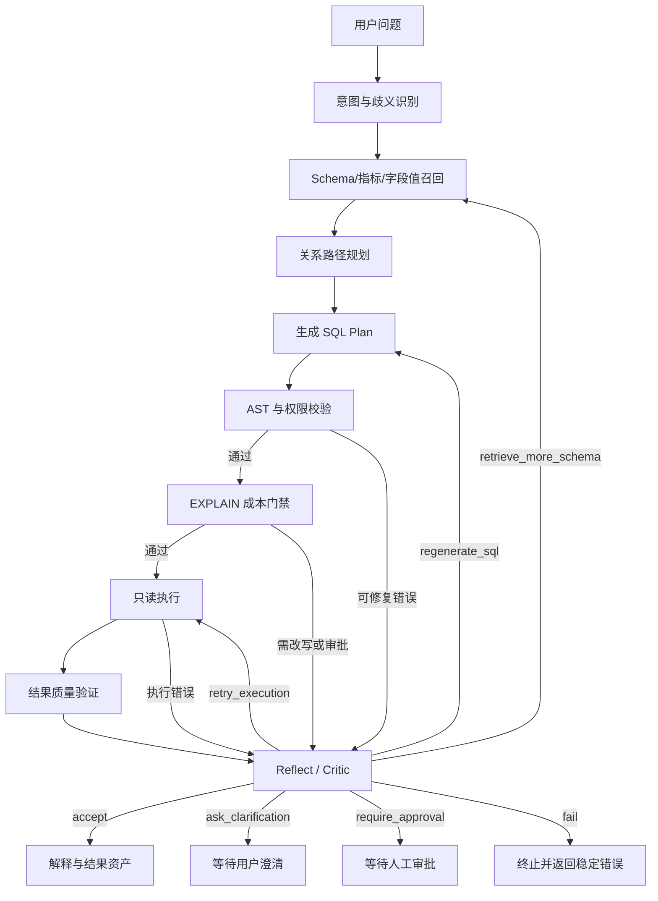

# Query Pilot 完整反思机制改造任务

## 1. 目标与当前判断

本专项把现有“失败后重新生成 SQL”的有界重试，升级为显式、结构化、可审计的反思机制。反思结果必须基于系统证据选择下一步动作，不能以自由文本替代状态机，也不能覆盖权限、SQL 安全、成本门禁和人工审批。

当前基线：

- `app/agent/graph.py` 的 bounded 运行时会把上一轮错误文本加入下一轮生成问题，最多修复 `AGENT_MAX_REPAIRS` 次。
- `app/agent/langgraph_adapter.py` 的 LangGraph 运行时虽然具备校验/验证失败回路，但重新生成仍只使用原始问题，没有显式消费上一轮错误和修复证据。
- `VerificationResult` 当前只有 `accepted/reason/retryable/confidence`，无法表达失败类型、证据、下一步动作和修复指令。
- 查询应用层目前主要验证返回列和行结构，尚不能系统判断问题覆盖度、聚合粒度、JOIN 扇出、业务口径和空结果原因。

因此，当前能力应称为“错误反馈驱动的有界 SQL 自修复”，不能称为完整 Agent 反思。

## 2. 目标链路



## 3. 不可突破的边界

1. 权限拒绝、跨租户访问、写 SQL、Prompt 注入和确定性安全拒绝不得交给 LLM 改判。
2. 成本超限不得通过反思自动放宽阈值；只能改写 SQL、进入审批或失败。
3. 反思不保存模型的长篇思维过程，只保存结构化原因码、证据摘要、动作和 SQL 哈希。
4. 反思结果不得自动修改 Prompt、Skill、业务口径或长期记忆。
5. 用户显式提交的 SQL 校验失败后不得被模型静默替换成另一条 SQL。
6. 反思使用的 Schema、关系、结果摘要必须再次执行租户、角色、数据源和字段权限过滤。
7. 任何运行时异常都必须有总次数、分类型次数和时间预算，禁止无限循环。

## 4. 结构化契约

建议在现有 Agent 契约中新增以下领域对象，具体文件可在实施时按职责拆分，避免继续扩大 `contracts.py`：

```python
class ReflectionFailureType(str, Enum):
    NONE = "none"
    SYNTAX = "syntax"
    SCHEMA = "schema"
    RELATIONSHIP = "relationship"
    AGGREGATION_GRAIN = "aggregation_grain"
    BUSINESS_AMBIGUITY = "business_ambiguity"
    EMPTY_RESULT = "empty_result"
    RESULT_SHAPE = "result_shape"
    EXECUTION_TRANSIENT = "execution_transient"
    PERMISSION = "permission"
    SECURITY = "security"
    COST = "cost"


class ReflectionAction(str, Enum):
    ACCEPT = "accept"
    REGENERATE_SQL = "regenerate_sql"
    RETRIEVE_MORE_SCHEMA = "retrieve_more_schema"
    RETRY_EXECUTION = "retry_execution"
    ASK_CLARIFICATION = "ask_clarification"
    REQUIRE_APPROVAL = "require_approval"
    FAIL = "fail"


class ReflectionResult(BaseModel):
    accepted: bool
    failure_type: ReflectionFailureType
    reason_codes: list[str]
    evidence: list[str]
    action: ReflectionAction
    repair_instruction: str | None = None
    retryable: bool = False
    confidence: float = Field(ge=0.0, le=1.0)
```

反思上下文至少包含：原始问题、当前候选 Schema、关系路径、SQL AST 摘要、校验错误码、EXPLAIN 摘要、返回列/行数/截断状态、查询维度与指标、已知业务口径、历史修复次数。默认不包含数据库凭据、敏感参数值、完整结果行和模型内部推理文本。

## 5. 错误分类与动作矩阵

| 失败类型 | 默认动作 | 自动次数 | 说明 |
|---|---|---:|---|
| SQL 语法/方言错误 | `regenerate_sql` | 2 | 传递稳定错误码和受限修复指令 |
| 表/字段不存在 | `retrieve_more_schema` | 1 | 只扩大授权范围内的候选召回 |
| 关系路径缺失 | `retrieve_more_schema` | 1 | 补桥接表或人工关系，不猜测外键 |
| 等长路径或业务关系歧义 | `ask_clarification` / `require_approval` | 0 | 不由模型擅自选择业务路径 |
| 聚合粒度/JOIN 扇出 | `regenerate_sql` | 2 | 优先子查询/CTE 预聚合，仍走安全校验 |
| 空结果 | `ask_clarification` 或 `regenerate_sql` | 1 | 不自动删除时间、状态或权限条件 |
| 数据库瞬时错误 | `retry_execution` | 1 | 只重试相同 SQL，不重新生成 |
| 权限/租户/字段拒绝 | `fail` | 0 | 确定性硬拒绝 |
| SQL 安全/Prompt 注入拒绝 | `fail` | 0 | 不允许模型尝试绕过 |
| 成本超限 | `require_approval` / `regenerate_sql` | 1 | 禁止自动提高阈值 |
| 业务口径不明确 | `ask_clarification` | 0 | 用户或数据负责人确认 |

## 6. 分阶段改造任务

### REFLECT-00：现状契约与回归锁定

**目标**：先证明 bounded 与 LangGraph 当前行为及差异，避免改造过程中把既有审批、安全、任务和结果资产语义改坏。

**开发内容**：

- 建立当前生成、校验、执行、验证、失败、审批和最大修复次数的状态转移测试。
- 增加 LangGraph 失败重试上下文测试，测试先明确暴露“错误未进入下一轮生成”的现状。
- 固定用户显式 SQL 不被模型替换、权限拒绝不重试、安全拒绝不重试等回归。

**验收**：形成 RED 基线；记录当前两种运行时的差异，不修改生产行为。

### REFLECT-01：反思领域契约与错误分类

**目标**：建立受限的 `ReflectionContext`、`ReflectionResult`、失败类型、动作和原因码。

**开发内容**：

- 定义枚举和 Pydantic 契约，拒绝未知字段和非法动作组合。
- 建立异常到稳定错误类型的确定性映射。
- 明确哪些错误 `retryable=false`，哪些动作必须进入澄清或审批。
- 对证据项、修复指令、原因码数量和长度设置上限。

**验收**：契约测试覆盖合法组合、冲突组合、未知类型、超长证据和敏感值清洗。

### REFLECT-02：共享 ReflectionPolicy 与预算控制

**目标**：bounded 和 LangGraph 共用一套决策策略，避免两套运行时继续漂移。

**开发内容**：

- 新建纯确定性的 `ReflectionPolicy`，输入错误分类、证据和预算，输出允许动作。
- 分离 SQL 修复、Schema 扩召回、相同 SQL 瞬时重试、澄清和审批预算。
- 增加总节点数、总耗时和总模型调用上限。
- 权限、安全、租户和硬成本拒绝在进入 LLM Critic 前失败关闭。

**验收**：同一上下文在两种运行时得到相同动作；预算耗尽后稳定终止。

### REFLECT-03：LangGraph 错误上下文与显式 Reflect 节点

**目标**：修复 LangGraph 只拿原始问题重复生成的问题，并把隐藏重试改为显式状态节点。

**开发内容**：

- `generate` 使用结构化生成上下文，包含上一条 SQL 哈希/摘要、错误码、修复指令和次数。
- 增加 `reflect` 节点，接收 validate、cost、execute、verify 的失败结果。
- 新增 `retrieve_more_schema`、`ask_clarification`、`require_approval` 和 `fail` 路由。
- 保证每次重新生成仍经过 AST、权限、成本和审批全链路。

**验收**：错误证据确实进入下一轮生成；循环次数、路由和终止状态可由测试复现。

### REFLECT-04：bounded 运行时行为对齐

**目标**：保留兼容运行时，但不再依赖拼接自由文本错误实现修复。

**开发内容**：

- bounded 运行时接入同一个 `ReflectionPolicy` 和结构化上下文。
- 移除两种运行时之间不同的错误判定和重试计数语义。
- 保持配置降级能力；任一运行时关闭反思时仍能执行单次安全查询。

**验收**：用参数化测试验证 bounded/LangGraph 在固定案例中的状态、动作、次数和终态一致。

### REFLECT-05：确定性结果质量验证

**目标**：在调用 LLM Critic 前，用规则判断能够确定的结果质量问题。

**开发内容**：

- 校验问题要求的维度、指标、排序、Top N 和时间范围是否体现在 SQL/结果中。
- 检测一对多、多对多 JOIN 后聚合扇出风险，以及双事实表未预聚合风险。
- 检测空结果、异常放大、截断、重复维度、缺少软删除/状态/快照口径等风险信号。
- 只基于已授权 Schema、关系目录、SQL AST、EXPLAIN 和脱敏结果摘要生成证据。

**验收**：固定 gold/badcase 覆盖正确接受、错误拒绝、JOIN 扇出、错误粒度、空结果和截断场景。

### REFLECT-06：受控语义 Critic

**目标**：仅把规则无法确定的业务语义问题交给模型判断。

**开发内容**：

- 使用独立结构化 Prompt，模型只能返回 `ReflectionResult`，不能直接执行工具或修改安全策略。
- 仅在业务口径、问题覆盖度、关系语义等低确定性场景调用。
- 低置信度输出默认转为澄清或审批，不自动接受。
- 模型不可用、解析失败或超时时回退到保守动作，不影响显式 SQL 和确定性查询。

**验收**：无模型 Key、超时、非法 JSON、冲突动作、Prompt 注入和低置信度场景均失败关闭或转人工。

### REFLECT-07：DataTask、审计与前端可解释性

**目标**：让每次反思能够回放、排障和审计，但不泄露敏感数据或思维过程。

**开发内容**：

- 将反思步骤保存为 DataTask Step/Event：失败类型、原因码、动作、次数、证据摘要、SQL 哈希、模型/Prompt 版本。
- 审计记录租户、任务、动作和最终终态，不保存参数值、完整结果或异常原文。
- 任务详情时间线展示“检测问题 → 采取动作 → 最终结果”，隐藏内部敏感字段。
- 多轮追问每轮独立计数，不能继承上一轮已耗尽预算。

**验收**：刷新、任务恢复、审批后继续、跨租户拒绝、viewer 脱敏展示和窄屏页面均有回归。

### REFLECT-08：离线评测、灰度与完成门禁

**目标**：用固定数据证明反思提升质量，而不是只证明“多调用了一次模型”。

**开发内容**：

- 建立版本化反思评测集，覆盖语法、字段幻觉、关系错误、聚合扇出、空结果、业务歧义、权限、安全、成本和瞬时错误。
- 同时比较关闭反思、仅规则反思、规则+语义 Critic 三种模式。
- 增加指标：首次成功率、修复成功率、错误分类准确率、错误接受率、错误拒绝率、无效重试率、平均修复次数、延迟、Token 和成本。
- 增加 `off/shadow/enforced` 灰度模式；shadow 只记录建议，不改变线上动作。
- 编写回滚、告警和 badcase 纳入流程。

**验收**：固定评测可重复执行；安全/权限绕过数必须为 0；没有达到阈值时不得从 shadow 切到 enforced。

## 7. TDD 与提交顺序

每项任务必须遵循：

1. RED：先写失败测试和对应证据文档。
2. GREEN：只实现使本任务测试通过的最小代码。
3. REFACTOR：去除 bounded/LangGraph 重复逻辑，不改安全边界。
4. REGRESSION：运行反思专项、Agent、查询、权限、审批、成本、任务恢复和全量后端测试。
5. UI 任务额外执行前端构建、Playwright 和 390px/桌面视口检查。

建议提交顺序：`REFLECT-00 → 01 → 02 → 03 → 04 → 05 → 06 → 07 → 08`。在当前共享工作区存在大量未提交修改时，禁止为追求 checkpoint 提交而混入无关文件；应保留独立 TDD 证据和精确 diff。

## 8. 配置建议

建议新增以下配置，默认采用保守值：

```text
AGENT_REFLECTION_MODE=off|shadow|enforced
AGENT_REFLECTION_LLM_ENABLED=false
AGENT_REFLECTION_MAX_SQL_REPAIRS=2
AGENT_REFLECTION_MAX_SCHEMA_EXPANSIONS=1
AGENT_REFLECTION_MAX_EXECUTION_RETRIES=1
AGENT_REFLECTION_MAX_TOTAL_STEPS=12
AGENT_REFLECTION_TIMEOUT_SECONDS=30
AGENT_REFLECTION_MIN_CONFIDENCE=0.80
```

现有 `AGENT_MAX_REPAIRS` 在兼容期映射到 SQL 修复预算，迁移完成后再决定是否废弃；不能无提示改变现有部署行为。

## 9. 完成定义

只有同时满足以下条件，才可以称为“完整反思机制本地实现完成”：

- 九项任务全部完成并有 RED/GREEN 证据。
- bounded 和 LangGraph 在固定案例上路由语义一致。
- 安全、权限、租户和成本硬门禁不能被反思覆盖。
- SQL、Schema、关系、聚合、空结果、瞬时错误和业务歧义均有明确分类与动作。
- 每次反思可在任务时间线和审计中追溯，但不保存敏感值或内部思维过程。
- 固定评测同时报告质量收益、错误接受率、无效重试、延迟和成本。
- shadow 灰度通过后才能进入 enforced；真实企业业务准确率仍需企业问句、口径和目标数据库验收。

## 10. 当前进度

- [x] `REFLECT-00` 现状契约与回归锁定
- [x] `REFLECT-01` 反思领域契约与错误分类
- [x] `REFLECT-02` 共享 ReflectionPolicy 与预算控制
- [x] `REFLECT-03` LangGraph 错误上下文与显式 Reflect 节点
- [x] `REFLECT-04` bounded 运行时行为对齐
- [x] `REFLECT-05` 确定性结果质量验证
- [x] `REFLECT-06` 受控语义 Critic
- [x] `REFLECT-07` DataTask、审计与前端可解释性
- [x] `REFLECT-08` 离线评测、灰度与完成门禁

规划完成度：`9/9（100%）`。本地开发完成度：`9/9（100%）`。

实现摘要：

- bounded 与 LangGraph 共用结构化反思契约、分类型预算、显式状态转移和受控结果验证。
- 确定性规则覆盖问题要求、聚合粒度、JOIN 扇出、空结果、截断和口径不确定性；语义 Critic 只处理规则无法确定的问题。
- DataTask、审计和前端时间线保存可回放的结构化决策，viewer 隐藏内部证据、SQL 哈希和模型字段。
- 默认 `shadow + rules-only`；`enforced` 缺少通过的版本化评测报告时自动降级到 `shadow`。
- 当前 11 条版本化合成集门禁通过，安全/权限绕过为 0；该结果不代表真实企业业务准确率。

证据见：

- `docs/testing/reflect-00-04-core-runtime.tdd.md`
- `docs/testing/reflect-05-08-quality-critic-observability-eval.tdd.md`
- `docs/operations/reflection-rollout.md`

“本地开发完成”只表示计划内代码、测试、前端展示和合成评测门禁完成。真实企业口径、线上 badcase、生产容量、在线 Critic 成本/延迟、真实多数据库实例和企业监控阈值仍未验收。
